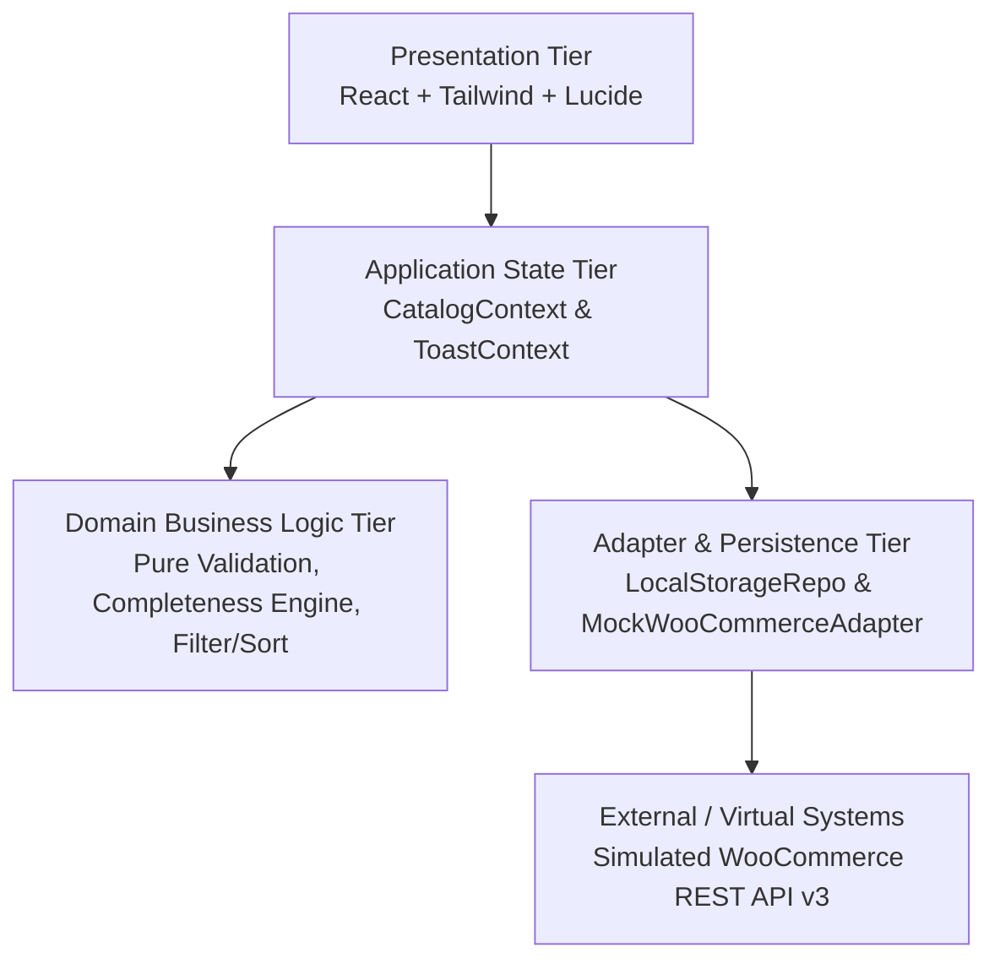
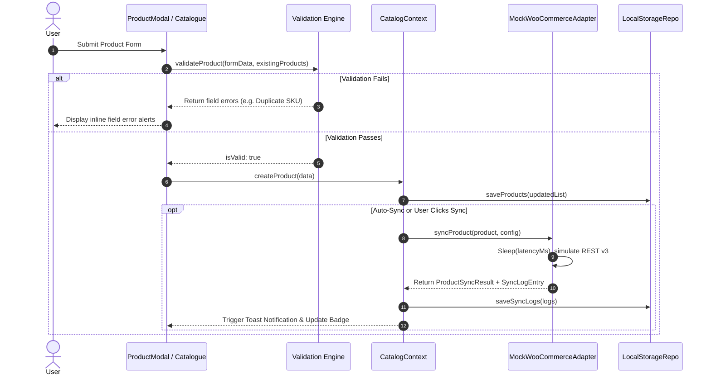

# CatalogSync — System Architecture & Design Documentation

## 1. Architectural Overview

CatalogSync is structured following Clean Architecture and Domain-Driven Design (DDD) principles. The system enforces strict separation of concerns across four primary tiers:



---

## 2. Layer Responsibilities

### 2.1 Domain Layer (`src/domain/`)
- **Zero external dependencies**: Contains pure TypeScript functions free of React, browser DOM, or API dependencies.
- **Validation Engine (`validation.ts`)**:
  - Enforces SKU uniqueness across the entire catalogue (case-insensitive comparison).
  - Validates positive numerical pricing, regular vs. sale prices, and integer stock quantities.
  - Enforces dynamic attribute validity (no blank names with values, no duplicate attribute keys per product).
- **Completeness Engine (`completeness.ts`)**:
  - Evaluates data quality percentage (0–100%) against essential and recommended e-commerce attributes.
  - Provides actionable field recommendations for merchandisers.
- **Filter & Sort Engine (`filterSort.ts`)**:
  - Multi-attribute text search across titles, SKUs, categories, descriptions, and dynamic attribute key-values.
  - Predictable sorting by recently modified, name, price, stock, and completeness.

### 2.2 Adapter Layer (`src/adapters/`)
- **Pluggable Interface (`syncAdapter.interface.ts`)**:
  ```typescript
  export interface ISyncAdapter {
    readonly adapterName: string;
    readonly isDemo: boolean;
    syncProduct(product: Product, config: SyncSimulationConfig): Promise<ProductSyncResult>;
    syncBatch(products: Product[], config: SyncSimulationConfig): Promise<BatchSyncResult>;
  }
  ```
- **Demo WooCommerce Adapter (`mockWooCommerceAdapter.ts`)**:
  - Translates internal `Product` models into WooCommerce REST API v3 `/wp-json/wc/v3/products` JSON payloads.
  - Generates realistic HTTP status codes (200 OK, 201 Created, 400 Bad Request, 422 Unprocessable Entity, 429 Rate Limit, 500 Server Error).
  - Simulates configurable network latency and error injection without risking live production credentials.
- **Persistence Adapter (`localStorageRepo.ts`)**:
  - Handles versioned JSON storage in `localStorage`.
  - Automatic seed data initialization for instant zero-config demonstration.
  - Full catalogue import/export utility.

### 2.3 Application State Tier (`src/context/`)
- **`CatalogContext.tsx`**:
  - Exposes reactive catalogue state, search and filtering state, multi-select queue, and async synchronization triggers.
  - Coordinates optimistic UI updates and audit logging.
- **`ToastContext.tsx`**:
  - Dispatches non-blocking alerts (`success`, `warning`, `error`, `info`) with auto-dismiss timers.

### 2.4 Presentation Tier (`src/components/`)
- **Atomic, Focused Components**:
  - `layout/`: Responsive header, tab bar, demo banner.
  - `dashboard/`: KPI cards, completeness distribution bar, remote store health summary.
  - `catalogue/`: High-density `ProductTable`, visual `ProductGrid`, batch action toolbar, filter drawer, empty states.
  - `product-modal/`: Dynamic attribute row editor with suggestion chips and live data quality scoring.
  - `sync/`: Sync queue, audit log table, JSON payload inspection modal, simulation configuration dialog.
  - `common/`: Badges, buttons, modals, and destructive action confirm dialogues.

---

## 3. Data Flow Diagram



---

## 4. Key Design Decisions

1. **Pure Domain Logic Separation**:
   By keeping validation and completeness logic in pure functions, we achieved 100% test coverage with zero mocking overhead in Vitest.
2. **Pluggable Sync Adapter**:
   The application UI does not know or care that it is communicating with a mock adapter. Switching to a live server-side WooCommerce integration requires only implementing `ISyncAdapter`.
3. **No Secrets in Frontend Code**:
   In adherence to security best practices, no WooCommerce API keys or secrets are stored in the client bundle. The demo simulation runs safely and transparently in-browser.
4. **Resilient Local Persistence**:
   Seed data restores instantly with the "Reset Demo Data" button, ensuring the reviewer can test destructive operations (deletion, errors) and immediately recover state.
